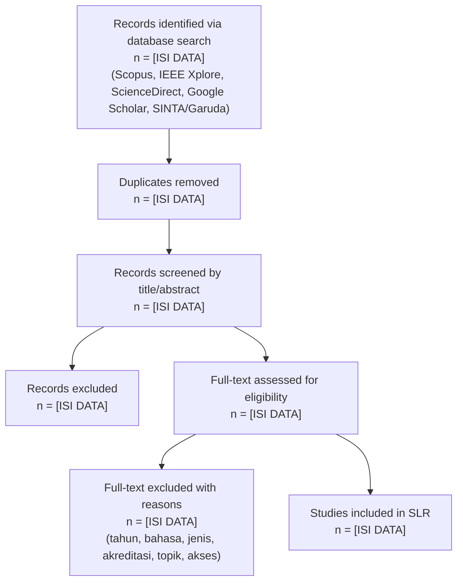

# Protokol dan Draf Systematic Literature Review (SLR) — PRISMA

**Topik:** Implementasi *Clean Architecture* dengan GetX untuk aplikasi *mobile* pendeteksi hoaks yang bergantung pada layanan pembelajaran mesin (Random Forest, SHAP, LIME)
**Penyusun:** Rivai (NIM 20230801290), Teknik Informatika, Universitas Esa Unggul
**Versi / tanggal:** 1.0 / 28 Oktober 2026

> **Status dokumen (baca dulu).**
> 1. Pencarian sistematik pada Bagian 2 **belum dijalankan**. Seluruh angka PRISMA (Bagian 4) berupa placeholder `[ISI DATA]`; tidak ada angka yang dikarang.
> 2. Bagian 5 memuat 19 studi yang berasal dari **penelusuran literatur proposal**, bukan dari hasil protokol ini. Seluruhnya terverifikasi (metadata dan DOI dicek ke Crossref); kolom "Kedalaman baca" menyatakan apa yang benar-benar dibaca. Setelah pencarian dijalankan, baris ini diganti atau dilengkapi.
> 3. Skor kualitas (Bagian 7) sengaja **tidak diisi**; hanya rubrik dan bukti bacaan yang disediakan, karena penilaian harus dilakukan peneliti setelah membaca teks lengkap.
> 4. Sitasi di luar yang terverifikasi ditandai **[PERLU VERIFIKASI DI MENDELEY]**.

---

## 1. Research Questions (RQ SLR, turunan PICOS)

Kerangka PICOS: **P** aplikasi *mobile* Android/Flutter yang memanggil layanan klasifikasi; **I** arsitektur berlapis dan pengelolaan status (*Clean Architecture*, GetX), kontrak API, penanganan kegagalan; **C** arsitektur konvensional atau pola lain (Provider, BLoC, MVVM, MVP); **O** modularitas, kemampuan uji, kinerja, serta kinerja model; **S** aplikasi dan data deteksi hoaks.

| Kode | Pertanyaan |
|---|---|
| RQ1 | Arsitektur, pola pengelolaan status, dan metode apa yang paling banyak digunakan pada aplikasi *mobile* (khususnya Flutter/Android) serta pada deteksi hoaks berbahasa Indonesia pada periode 2021–2026? |
| RQ2 | Objek studi dan dataset apa yang umum digunakan (aplikasi studi kasus, korpus hoaks, sumber data)? |
| RQ3 | Metrik evaluasi apa yang digunakan untuk mengukur kualitas arsitektur, pengujian, kinerja aplikasi, dan kinerja model, serta bagaimana tren terbarunya? |
| RQ4 | Apa keterbatasan penelitian terdahulu dan peluang riset ke depan, khususnya pada aplikasi *mobile* yang bergantung pada layanan ML yang dapat lambat, gagal, atau memilih *abstain*? |

---

## 2. Search Strategy

**Database:** Scopus, IEEE Xplore, ScienceDirect, Google Scholar. Untuk literatur Indonesia (sesuai batasan SINTA 4 ke atas): SINTA dan Garuda.
**Rentang tahun:** 2021–2026 (`PUBYEAR > 2020 AND PUBYEAR < 2027`).
**Pencarian terakhir dijalankan:** 28 Oktober 2026, hanya pada Scopus (basis data lain belum). Untai S-D dijalankan dengan kedua bagiannya dalam tanda kurung agar batas tahun berlaku pada keduanya.

**Hasil Scopus (2021–2026):** S-A 132, S-B 55, S-C 975, S-D 207 (total 1.369; gabungan tanpa duplikat antaruntai 1.355). Setelah penyaringan jenis dokumen (artikel dan prosiding) dan bahasa (Inggris dan Indonesia): S-A 112, S-B 50, S-C 818, S-D 186; gabungan 1.153.

| Untai | Fokus | *String query* (sintaks Scopus) |
|---|---|---|
| S-A | Arsitektur dan status | `TITLE-ABS-KEY ( ( "Clean Architecture" OR "layered architecture" OR "MVVM" OR "MVP" OR "state management" OR "dependency injection" ) AND ( "Flutter" OR "Android" OR "mobile application" ) ) AND PUBYEAR > 2020 AND PUBYEAR < 2027` |
| S-B | Hoaks dan XAI | `TITLE-ABS-KEY ( ( "hoax" OR "fake news" OR "misinformation" OR "disinformation" ) AND ( "Indonesian" OR "Bahasa Indonesia" OR "mobile application" ) AND ( "Random Forest" OR "TF-IDF" OR "IndoBERT" OR "SHAP" OR "LIME" OR "explainable" ) ) AND PUBYEAR > 2020 AND PUBYEAR < 2027` |
| S-C | Pengujian dan kualitas | `TITLE-ABS-KEY ( ( "widget test" OR "golden test" OR "flaky test" OR "code coverage" OR "testability" OR "maintainability" OR "coupling" ) AND ( "mobile app" OR "Flutter" OR "Android" ) ) AND PUBYEAR > 2020 AND PUBYEAR < 2027` |
| S-D | *Abstain* dan integrasi layanan | `TITLE-ABS-KEY ( ( "reject option" OR "abstention" OR "selective classification" ) AND ( "deployed" OR "application" ) ) OR TITLE-ABS-KEY ( ( "REST API" ) AND ( "machine learning" ) AND ( "mobile application" ) ) AND PUBYEAR > 2020 AND PUBYEAR < 2027` |

Adaptasi: IEEE Xplore (`"All Metadata"`, *Publication Year* 2021–2026), ScienceDirect (*Title, abstract, keywords*, *Research articles*), Google Scholar (`allintitle:`/frasa kunci, 200 hasil teratas per untai). Padanan Indonesia untuk SINTA/Garuda: "arsitektur bersih", "manajemen status", "deteksi hoaks", "aplikasi mobile Flutter".

---

## 3. Inclusion & Exclusion Criteria

| Kriteria | Inclusion | Exclusion |
|---|---|---|
| Tahun | 2021–2026 | < 2021 (kecuali sumber teori klasik yang dikutip terpisah sebagai landasan, bukan studi SLR) |
| Bahasa | Inggris atau Indonesia | Selain keduanya |
| Jenis | Artikel jurnal dan prosiding *peer-reviewed* | *Blog*, opini, tesis, laporan teknis, dan non-*peer-reviewed* |
| Kualitas sumber | Jurnal SINTA 4 ke atas atau Scopus Q3 ke atas | Di bawah ambang akreditasi |
| Topik | Relevan dengan arsitektur/pengelolaan status/pengujian aplikasi *mobile*, atau deteksi hoaks dengan atau tanpa penjelasan model | Tidak relevan dengan topik |
| Ketersediaan | Teks lengkap dapat diakses | Hanya abstrak dan tidak dapat diakses setelah upaya wajar |
| Duplikasi | Versi terlengkap | Versi ganda atau pendahulu dari penelitian yang sama |

---

## 4. PRISMA Flow Diagram

Hanya tahap identifikasi pada Scopus yang tersedia (28 Oktober 2026): 1.369 catatan, 1.355 setelah duplikat antaruntai dibuang, 1.153 setelah penyaringan jenis dokumen dan bahasa. Tahap berikutnya masih `[ISI DATA]`.

---

## 5. Data Extraction Form

Berisi 19 studi dari penelusuran proposal. **Kedalaman baca:** *TL* = teks lengkap; *AB* = abstrak saja. Kolom `[ISI DATA]` berarti rincian belum diekstraksi.

| Kode | Penulis, tahun (DOI) | Metode | Dataset / objek | Hasil utama | Limitasi | Baca |
|---|---|---|---|---|---|---|
| S1 | Azziqra & Nuryasin, 2025 (10.35145/joisie.v8i2.4763) | *Clean Architecture* pada Flutter, penilaian model McCall | Aplikasi *mobile* Al-Quran | Kemudahan pemeliharaan 79% (baik) | Satu studi kasus dan satu aspek kualitas; tanpa layanan klasifikasi | TL |
| S2 | Defriani dkk., 2026 (10.60005/coreid.v4i2.163; DOI belum terdaftar di doi.org, gunakan tautan jurnal) | MVVM + *Clean Architecture* pada Android, XP | Aplikasi Android | Sembilan berkas uji lulus; setiap lapisan dapat diuji mandiri | Platform Android asli; tanpa uji integrasi dan layanan luar | TL |
| S3 | Zulistiyan dkk., 2024 (10.47065/josh.v5i2.4698) | Perbandingan GetX dan BLoC | Data 1.000, 5.000, 10.000 entri | GetX lebih hemat memori pada data kecil; BLoC unggul CPU pada data besar | Hanya kinerja *runtime* | AB |
| S4 | Subandri dkk., 2026 (10.32520/stmsi.v15i4.6237) | Provider vs *setState* | Aplikasi apotek Flutter | *Rebuild* berkurang 52,3%; *frame* < 16 ms; kopling rendah | Bukan GetX; tanpa kemampuan uji | TL |
| S5 | Jatnika dkk., 2023 (10.25126/jitecs.202382557) | Perbandingan pengelola status (GetX, Riverpod) | Aplikasi *e-commerce* Flutter | GetX lebih hemat memori dan lebih cepat dari Riverpod; Riverpod dianggap lebih mudah dirawat | Tidak menilai kemampuan uji | TL |
| S6 | Sanjaya & Laksana, 2025 (10.35960/ikomti.v6i3.2033) | XP; Flutter + Laravel di *cloud*; *black box*, SUS, JMeter | Layanan pelanggan | SUS 80,1; respons 1,8–2,3 detik | Bukan klasifikasi teks; kualitas arsitektur tidak diukur | TL |
| S7 | Asshifa dkk., 2026 (10.32736/sisfokom.v15i3.2646) | Flutter + *RESTful* API, ADDIE | Aplikasi data statistik BPS | Respons 437–826 ms vs 1.368–1.790 ms pada web | Fokus efisiensi akses data | TL |
| S8 | Firdaus & Afwani, 2024 (10.29303/jtika.v6i1.335) | REST API untuk model ML pada aplikasi *mobile* | Klasifikasi jenis tanah | Dokumentasi *endpoint* sebagai kontrak; uji *black box* Postman | Bukan deteksi teks | TL |
| S9 | Kartarina & Apriliansyah, 2022 (10.35889/progresif.v18i1.781) | Injeksi dependensi manual vs otomatis, MVP | Aplikasi Android | Kopling sebagai indikator kualitas | `[ISI DATA]` | TL |
| S10 | Pontillo dkk., 2024 (10.1016/j.infsof.2023.107394) | Tinjauan literatur kelabu + survei 130 pengembang | Pengembang aplikasi *mobile* | *Flaky test* terkait elemen UI | Persepsi pengembang; tanpa kaitan arsitektur | AB |
| S11 | Pamungkas & Samihardjo, 2024 (10.15408/aism.v7i2.38876) | *White box* (siklomatik) dan *black box* | Aplikasi perpustakaan web | Validitas 100% pada 10 skenario | Aplikasi web | TL |
| S12 | Zhang dkk., 2024 (10.1145/3635713) | Survei efektivitas rangkaian uji | Literatur pengujian | Cakupan saja tidak cukup menilai efektivitas uji | `[ISI DATA]` | AB |
| S13 | Alirridlo dkk., 2025 (10.29207/resti.v9i6.6825) | Korelasi ISO 25010 modularitas, metrik CK, *architectural smell* | Enam proyek Java sumber terbuka | *Smell* tertentu berkorelasi kuat dengan metrik CK | Java, bukan Flutter | TL |
| S14 | Irawan & Sudarmaji, 2026 (10.63158/journalisi.v8i4.1710) | RF, SVM, NB, XGBoost dengan BoW/TF-IDF | 1.116 artikel Mafindo/TurnBackHoax | RF+BoW terbaik, akurasi 98,66%, F1 98,59% | Satu dataset; belum divalidasi pada sumber lain | TL |
| S15 | Yefferson dkk., 2024 (10.11591/ijai.v13.i2.pp1913-1924) | IndoBERT-LSTM | 5.876 artikel (turnbackhoax.id, CNN Indonesia) | Akurasi 93,2%, F1 90,8% | Kelas dari sumber berbeda (risiko kebocoran); tanpa uji eksternal | TL |
| S16 | Hashmi dkk., 2024 (10.1109/ACCESS.2024.3381038) | FastText + CNN-LSTM; LIME dan LDA | WELFake, FakeNewsNet, FakeNewsPrediction | Akurasi dan F1 0,97–0,99 | Penjelasan tidak sampai ke aplikasi *mobile* | TL |
| S17 | Sahtyawan & Yudhana, 2026 (10.11591/eei.v15i4.11351) | SVM, NB, RF dengan TF-IDF | 4.009 artikel | SVM terbaik (akurasi 97%, F1 96%) | Hanya perbandingan algoritma | AB |
| S18 | Ariatmanto & Rifai, 2024 (10.29207/resti.v8i6.6017) | RF dengan TF-IDF | 44.898 artikel ISOT (Inggris) | Akurasi 99,0% | Data berbahasa Inggris; tanpa penjelasan dan aplikasi | AB |
| S19 | Hendrickx dkk., 2024 (10.1007/s10994-024-06534-x) | Survei klasifikasi dengan opsi menolak | Literatur ML | *Abstain* meningkatkan kinerja pada contoh yang diputuskan dan kepercayaan | Cakupan menurun bila banyak ditolak | AB |

*Catatan:* S14, S15, S16 memakai dataset dan metrik berbeda sehingga angka tidak dibandingkan langsung.

**Kandidat belum diekstraksi** (metadata dicek di OpenAlex; isi belum dibaca): *Cross-Temporal Generalization of IndoBERT for Indonesian Hoax News Classification*, Jutif 2025 (10.52436/1.jutif.2025.6.5.4757); *Comparison of LSTM and IndoBERT Method in Identifying Hoax on Twitter*, Jurnal RESTI 2023 (10.29207/resti.v7i3.4830); *Comparative Analysis of MVVM and MVP Patterns Performance on Android…*, JNTETI 2025 (10.22146/jnteti.v14i2.18985); *Responsible model deployment via model-agnostic uncertainty learning*, *Machine Learning* 2022 (10.1007/s10994-022-06248-y). **[PERLU VERIFIKASI DI MENDELEY]** (akreditasi, teks lengkap, dan relevansi).

---

## 6. Synthesis & Thematic Analysis

Hasil sintesis berikut **bersifat awal** dan hanya mencerminkan 19 studi pada Bagian 5.

| Tema | Studi | Temuan |
|---|---|---|
| **T1. Arsitektur berlapis** (4) | S1, S2, S9, S13 | Dinilai pada satu aspek (pemeliharaan, uji per lapisan, kopling); metrik ketergantungan antarberkas belum dipakai pada Flutter |
| **T2. Pengelolaan status dan kinerja** (3) | S3, S4, S5 | Dominan membandingkan kinerja *runtime* (memori, CPU, *rebuild*); kemampuan uji tidak dinilai |
| **T3. Integrasi layanan dan REST** (3) | S6, S7, S8 | REST/JSON sebagai kontrak; fokus waktu respons dan efisiensi; penanganan kegagalan bertipe belum dibahas |
| **T4. Pengujian** (3) | S10, S11, S12 | Persepsi pengembang dan metode klasik; cakupan dipandang tidak cukup |
| **T5. Deteksi hoaks dan XAI** (5) | S14–S18 | Pengklasifikasi klasik (TF-IDF, BoW) dan IndoBERT; metrik hampir seluruhnya akurasi dan F1; penjelasan belum sampai ke aplikasi |
| **T6. Opsi menolak** (1) | S19 | Mulai muncul sebagai cara meningkatkan kepercayaan; belum dikaitkan dengan arsitektur aplikasi |

- **Dominan:** T1–T3 menilai satu aspek tunggal pada satu studi kasus.
- **Mulai muncul:** keterjelasan model (S16) dan opsi menolak (S19).
- **Belum dieksplorasi:** kombinasi kemampuan uji aplikasi, kegagalan layanan, dan evaluasi pada data eksternal dalam satu penelitian.

### Jawaban sementara RQ1–RQ3
- **RQ1:** arsitektur berlapis (*Clean Architecture*, MVVM, MVP) dan pengelola status (GetX, Provider, BLoC, Riverpod); pada hoaks, pengklasifikasi klasik dengan TF-IDF/BoW dan IndoBERT.
- **RQ2:** objek studi berupa aplikasi tunggal (Al-Quran, apotek, *e-commerce*, statistik); korpus hoaks dari Mafindo/TurnBackHoax, CNN Indonesia, dan korpus berbahasa Inggris (ISOT, WELFake).
- **RQ3:** arsitektur (McCall, kopling, metrik CK), kinerja (memori, CPU, *frame*, waktu respons), kegunaan (SUS), uji (cakupan, validitas skenario), model (akurasi, presisi, *recall*, F1).

---

## 7. Quality Assessment

Rubrik tiga kriteria, masing-masing 1–5, skor total 3–15.

| Kriteria | 1 | 3 | 5 |
|---|---|---|---|
| K1 Relevansi | Tidak terkait RQ | Terkait sebagian | Menjawab RQ secara langsung |
| K2 Metodologi | Tanpa metode jelas | Metode ada, validasi terbatas | Metode, data, dan pembanding jelas dan sesuai |
| K3 Pelaporan | Hasil tidak lengkap | Hasil dan keterbatasan sebagian | Metrik, data, dan keterbatasan dilaporkan lengkap |

| Studi | K1 | K2 | K3 | Skor (3–15) | Bukti bacaan |
|---|---|---|---|---|---|
| S1 | `[ISI SKOR]` | `[ISI SKOR]` | `[ISI SKOR]` | `[ISI SKOR]` | Teks lengkap |
| S2 | `[ISI SKOR]` | `[ISI SKOR]` | `[ISI SKOR]` | `[ISI SKOR]` | Teks lengkap |
| S3 | `[ISI SKOR]` | `[ISI SKOR]` | `[ISI SKOR]` | `[ISI SKOR]` | Abstrak saja |
| S4–S19 | `[ISI SKOR]` | `[ISI SKOR]` | `[ISI SKOR]` | `[ISI SKOR]` | Lihat kolom "Baca" Bagian 5 |

Skor tidak diisi sengaja; penilaian dilakukan peneliti, sebaiknya dengan dua penilai, setelah teks lengkap dibaca. Studi berstatus *AB* wajib dibaca penuh sebelum dinilai.

---

## 8. Research Gap Matrix

| Jenis gap | Deskripsi gap | Peluang riset |
|---|---|---|
| **Metodologis** | Penelitian arsitektur Flutter menilai satu aspek (pemeliharaan atau kinerja); kemampuan uji dan keterisolasian perubahan belum diukur bersama | Mengukur modularitas, kemampuan uji, dan studi kasus perubahan sebelum dan sesudah restrukturisasi dengan skrip yang dapat diulang |
| **Dataset** | Korpus hoaks berasal dari satu atau dua sumber dengan risiko label berkorelasi sumber; uji eksternal jarang | Data dari sumber berbeda, pemeriksaan duplikat dan kemiripan, serta uji lintas waktu dan sumber |
| **Konteks** | Penjelasan model dan layanan ML jarang dikaji dari sisi aplikasi *mobile* (lambat, gagal, berubah, atau *abstain*) | Pemetaan kegagalan layanan ke tampilan dan kontrak API pada aplikasi hoaks |
| **Performa** | Latensi *end-to-end* di ponsel termasuk penjelasan SHAP dan LIME jarang dilaporkan; metrik model terbatas pada akurasi | Pemisahan waktu prediksi, penjelasan, dan jaringan di perangkat nyata; pelaporan selang kepercayaan dan cakupan opsi menolak |

---

## 9. Kesimpulan & Rekomendasi

**Ringkasan jawaban RQ.** RQ1: pola berlapis dan pengelola status mendominasi pada sisi *mobile*, pengklasifikasi klasik dan IndoBERT pada sisi hoaks. RQ2: objek studi berupa aplikasi tunggal dan korpus hoaks dari sedikit sumber. RQ3: metrik arsitektur dan kinerja beragam tetapi masing-masing berdiri sendiri; metrik model terpusat pada akurasi dan F1. RQ4: keterbatasan utama adalah penilaian satu aspek, ketiadaan uji eksternal, dan terputusnya penjelasan model dari aplikasi.

**Rekomendasi arah penelitian.** Memosisikan penelitian pada irisan yang belum dikaji: **kualitas arsitektur aplikasi *mobile* (modularitas, kemampuan uji, keterisolasian perubahan) pada aplikasi yang bergantung pada layanan klasifikasi yang dapat gagal, lambat, atau memilih *abstain***, dengan layanan ML diperlakukan sebagai komponen pendukung yang kinerjanya dilaporkan jujur. Ini sejalan dengan judul proposal.

**Langkah berikutnya sebelum dokumen ini final:** (1) jalankan pencarian Bagian 2 dan isi angka PRISMA; (2) baca penuh studi berstatus *AB*; (3) isi skor kualitas; (4) verifikasi kandidat tambahan di Mendeley.
